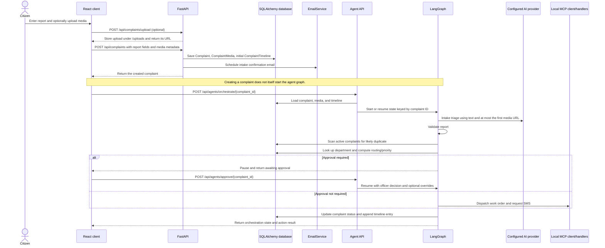

# Phase 0 snapshot: How Namma Civic worked at the baseline

> Historical snapshot from Phase 0. Later phases changed the graph, schema, duplicate resolver, privacy rules, and follow-up behavior. For the current architecture, read [`README.md`](README.md) in this learning folder and [`04-agent-pipeline.md`](04-agent-pipeline.md).

This guide describes the Phase 0 baseline implementation. It distinguishes code that ran locally from real external civic operations at that point in the project.

## Main pieces

- `frontend/` is a React and Vite client with citizen, officer, and admin pages.
- `backend/app/main.py` creates the FastAPI app and calls `init_db()` during application startup.
- `backend/app/api/` exposes HTTP endpoints; `backend/app/services/` contains business operations.
- `backend/app/models/` defines SQLAlchemy records. The current core record is `Complaint`, with related media, timeline entries, and AI analysis.
- `backend/app/agents/` contains a six-node LangGraph. `backend/app/mcp/` registers local Python handlers for map, civic, and notification tools.

## Complaint lifecycle

The graph checkpointer is `MemorySaver`, so its state is held in process memory and does not survive a server restart. Complaint records themselves are stored separately in the configured database.

## Agent node reference

| Node | Inputs | Outputs | Database writes | Failure behavior |
|---|---|---|---|---|
| `intake` (`agents/nodes/intake_node.py`) | Complaint title, description, optional address/landmark, category, and the first media URL if present | Summary, detected category, confidence, urgency, severity, extracted entities, vision result, provider/model metadata | None | Provider errors are not caught in the node; graph invocation fails. |
| `validation` (`agents/nodes/validation_node.py`) | Title, description, coordinates, intake confidence | Validity, spam score, actionability, flags, reason | None | Rule-based; unexpected errors propagate. Invalid reports route to approval. |
| `deduplication` (`agents/nodes/deduplication_node.py`) | Complaint ID, coordinates, title, description, category | Duplicate flag, first matching complaint ID, distance, token similarity, generated `cluster_id` | Reads active complaints; no incident/link write | Database exceptions are logged and treated as no duplicate. Without coordinates it returns no duplicate. |
| `routing` (`agents/nodes/routing_node.py`) | Intake category/severity/urgency, validation, duplicate result | Department, priority, SLA, rationale, human-approval flag/reason | Reads department by code | Department lookup errors are logged; routing falls back to a generic department label. |
| `approval` (`agents/nodes/approval_node.py`) | Approval state, officer decision and optional department/priority overrides | Awaiting/approved/rejected state and possibly updated routing | None | State-only logic; no error recovery is defined. The graph ends while waiting, or proceeds after a decision. |
| `action` (`agents/nodes/action_node.py`) | Complaint ID, routing result, officer decision | Work-order ID, action status, notification telemetry, timeline note | Attempts to update complaint and append timeline | MCP exceptions are logged and execution continues with a generated fallback ID. Database exceptions are logged and swallowed; the result can still say `dispatched`. |

## What is implemented versus simulated

| Area | Current behavior |
|---|---|
| Complaint records | SQLAlchemy models write to the configured SQLite or PostgreSQL database. `init_db()` currently calls `Base.metadata.create_all()`; there are no checked-in migration revisions under `backend/migrations/versions/`. |
| AI | Provider adapters exist for mock, Groq, Gemini, and OpenAI. The mock provider uses deterministic heuristics and simulates image/audio analysis. The test fixture forces mock AI; this Phase 0 test run also set `AI_MODE=mock` and `AI_PROVIDER=mock`. No live LLM calls were made. |
| MCP tools | The MCP client dispatches directly to Python functions in `backend/app/mcp/servers/`; these are not standalone external MCP servers. The civic dispatch handler generates an in-process work-order-like ID; it does not connect to a municipal work-order platform. |
| SMS | The current notification handler returns a synthetic `DELIVERED` result; it does not send an SMS. The action node passes a hardcoded number. |
| Email | `EmailService` writes to an in-memory simulated outbox when SMTP credentials are absent. If SMTP credentials are configured, its implementation can send real SMTP messages. Test commands in this phase ran from a clean temporary directory with no `.env` file and used default empty email credentials, so they used simulated email. |
| Maps/GIS | The local tool handler calls the GIS service, which can use configured providers and has fallback coordinates/labels. Traffic classification in the MCP handler is a coordinate-based heuristic. |
| SLA, resolution, analytics | Services and APIs implement database-backed state changes and calculations, but external dispatch, field work, and physical resolution are not performed by this repository. Resolution verification uses the configured AI service and is not proof that a crew completed real-world work. |

## Confirmed project review findings

1. **Duplicate reports do not become links.** A duplicate result can make routing request officer review, but the action path still dispatches a new work order after approval. No common incident is created.
2. **There is no incident or report-link data model.** The dedup node's `cluster_id` is only a formatted string; it is not persisted.
3. **Deduplication has the reviewed limits.** It uses a fixed 100 m radius and token Jaccard similarity, checks only category/text/location, scans all active rows returned by the query in Python, takes the first acceptable row, and catches database errors as “not a duplicate.”
4. **Source channel is stored but not used in routing or deduplication.** The intake node examines only the first media URL.
5. **README structure and agent count do not match the checkout.** The graph has six nodes, not ten. Internal `backend/app/mcp/servers/` exists; top-level `mcp-servers/` and `database/` do not. Alembic configuration exists, but the claimed `0001`–`0003` migration revisions are absent; runtime initialization uses `create_all()`.
6. **Action reporting is unreliable.** SMS uses a hardcoded number. MCP errors and database errors can be swallowed while the result says `dispatched`.
7. **The reported test failure is a test initialization issue, not just an environment problem.** The tests use HTTPX `ASGITransport`, which does not start FastAPI lifespan by default. The app's schema creation is in lifespan, while the original `conftest.py` had no database initialization fixture. In this session the suite passed after adding that fixture. A separate shell configuration issue (`DEBUG=release`) also prevented the initial test command from importing settings; Phase 0 commands override `DEBUG` explicitly.
8. **Hotspot clustering is separate from duplicate detection.** `AnalyticsService.get_geospatial_hotspots()` has nested Python loops over complaint rows. It identifies geographic hotspot zones and does not link duplicate reports.

## What this phase does not solve

The duplicate-to-incident constraint remains open. The current system preserves individual complaint records, but it does not associate multiple reports with one incident or enforce one work order for those reports.
