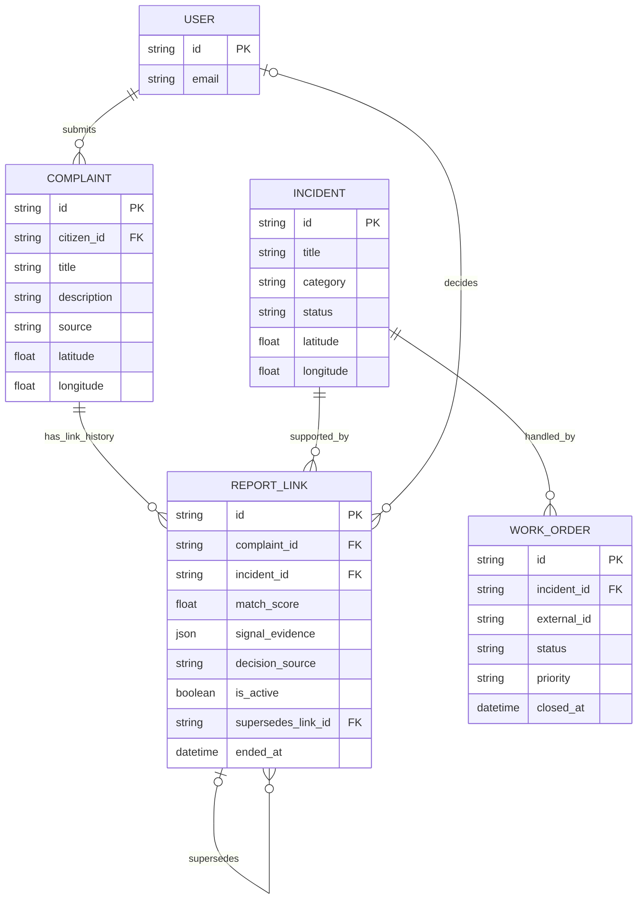

# Phase 1: Incidents, reports, and work orders

## The three concepts

- **Complaint** is one citizen's original evidence: reporter, text, location, channel, photos, and timestamps. The incident model does not copy over or replace that record.
- **Incident** is the civic issue being handled. Several complaint reports may support the same incident.
- **ReportLink** records which incident a complaint currently supports, along with match score, signal evidence, decision source, and history when an officer changes the association.
- **WorkOrder** is a persisted unit of municipal work for an incident. The database allows at most one active work order for an incident.

## Entity relationship diagram



One complaint can have multiple historical ReportLink rows after officer corrections, but only one may be active. A report's reporter is found through its Complaint. The citizen set for an Incident is therefore derived by following active links to complaints and collecting their `citizen_id` values; the Incident does not maintain a second reporter list that could drift out of sync.

## Database invariants

| Invariant | Enforcement |
|---|---|
| One active incident association per complaint | Partial unique index on `report_links.complaint_id` where `is_active` is true. This permits old superseded link rows while preventing two current links. |
| Every supported complaint has one incident association | Backfill creates one active link for every existing complaint. The API intake and demo seed paths create the complaint, incident, and active link in one transaction. A relational database cannot directly require that a child link row exists for every parent complaint, so direct SQL writers must follow the same transaction rule. |
| At most one active work order per incident | Partial unique index on `work_orders.incident_id` for statuses other than `completed` and `cancelled`. Completed or cancelled work may be followed by a new active work order. |
| Preserve report evidence | Complaint text, location, source, media, and reporter remain on the Complaint. Moving a report closes its old link and inserts a new officer link that points back to the superseded link. |
| Derive reporters without duplicating identity data | Active ReportLinks join to Complaints; the Incident stores no reporter names, emails, or phone numbers. |

The “at least one active link” part of the complaint invariant is maintained by intake, seeding, backfill, and transactional officer reassignment. The database index enforces “at most one.” The Phase 1 tests exercise both supported creation paths and the index behavior.

## Worked example: five reports, one issue

This is an illustrative data-model example, not a claim about evaluated duplicate detection. Five citizens report the same pothole outside a bus stop, each preserving their own wording, channel, photo, and reporter:

| Report | Reporter | Channel | Original description | Link after duplicate review |
|---|---|---|---|---|
| C-101 | Citizen A | Web | “Large hole in the road by the bus stop.” | Active link to I-501 |
| C-102 | Citizen B | Mobile | “Cars keep swerving around broken asphalt near the shelter.” | Active link to I-501 |
| C-103 | Citizen C | WhatsApp | “There is a deep pothole opposite the bus stand.” | Active link to I-501 |
| C-104 | Citizen D | Voice transcript | “Road has a crater near the stop; bikes are falling.” | Active link to I-501 |
| C-105 | Citizen E | Web | “Same bus-stop pothole is getting worse after rain.” | Active link to I-501 |

The database contains five Complaint rows, one Incident row, and five active ReportLink rows. Each report retains its own evidence and reporter. The Incident reporter set is computed as the distinct reporters reached through those five links. The incident can have one active WorkOrder, regardless of the number of reports.

The Incident data model and initial report links are implemented in this phase. The current duplicate engine does not yet recognize these five reports as one issue, and the action node is not yet wired to create or reuse WorkOrders by Incident. Those behaviors are assigned to later phases.

## Link decisions and audit history

`ReportLink.decision_source` distinguishes `auto`, `officer`, and `backfill`. The extra `backfill` value records migration provenance accurately; migrated links were neither evaluated by the future duplicate engine nor confirmed by an officer.

When an officer changes a link, the current row is marked inactive with an end timestamp. The service creates a replacement row with `decision_source=officer`, the officer ID, a note, signal evidence, and `supersedes_link_id`. The unique active-link index means the transaction cannot commit with two current links for that report.

## Approved lifecycle policies

- A new report matching a resolved incident creates a new incident by default. Later work may send uncertain matches to an officer; reopening the old incident requires an explicit decision.
- A report that appears to bridge two incidents goes to officer review. The system must not silently merge two incidents based only on a possible match.
- If an officer rejects a report-to-incident association, the report is reassigned to a different or new incident and the previous link remains as history.

## Migration and backfill

The repository previously had Alembic configuration but no revision files. The new chain has a baseline revision for the six pre-incident tables and an incident revision that creates the new tables and backfills every existing complaint to its own incident and `backfill` link. Existing work-order IDs were not stored in the database, so there is no reliable historic work-order data to migrate.

At application startup, an empty database upgrades from the baseline through the incident revision. A complete unversioned legacy schema is stamped at the baseline and upgraded. Startup refuses to stamp an incomplete unversioned schema so it does not guess how to repair partial databases.

## Try it

From the `backend` directory in PowerShell, run the incident data-model and migration tests:

```powershell
& "$env:TEMP\civicfix-phase0-venv\Scripts\python.exe" -m pytest tests/test_incidents.py -q
```
