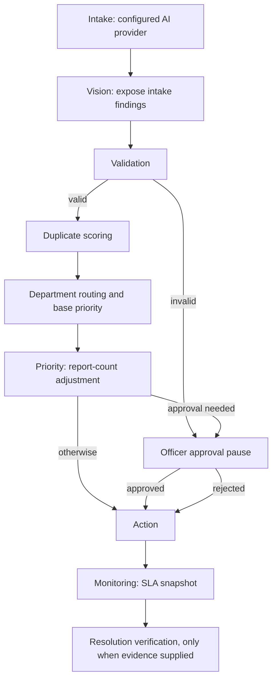

# Phase 4: Agent pipeline integration (updated through Phase 7)

## Current graph



The LangGraph checkpointer is `MemorySaver`. Graph state and paused approval state live only in this process; a restart loses the graph checkpoint. Complaint and incident rows are stored in the database, but they do not reconstruct the interrupted LangGraph state automatically.

## Citizen submission and officer triage

The report form first saves the complaint, then calls `/api/agents/orchestrate/{complaint_id}`. This starts duplicate resolution, routing, and action processing for a report created in the UI. If processing fails after saving, the page keeps the reference ID, says the report was saved, and offers a retry without posting a second complaint.

The default officer department queue includes reports with no department so they remain available for triage when processing has not completed. An explicit department filter stays limited to that department. Officers review uncertain duplicate matches in the separate duplicate-review queue. Citizens continue to see only their own reports; when reports are linked, their common incident tracker can show the reporter count without revealing other reporters' identities.

The officer queue groups active complaint links by incident and displays one card for the shared issue, with the number of distinct citizens who reported it. The original complaints remain stored and individually visible in each citizen's account. Pending legacy reports have a **Run triage** action so an officer can process the saved report without creating another complaint; the action resolver then links it, creates a new incident, or sends it to duplicate review based on evidence.

An end-to-end regression uses three **synthetic** reporters on different channels with varied descriptions, identical photo hashes, and the same coordinates. It verifies one incident card with three reporters, one reused work order, and an incident SLA priority increase. With the mock streetlight evidence in that scenario, the base priority is high; the third independent report raises it to critical, shortening the target SLA to 12 hours.

Work-order dispatch is serialized by the database intake mutex through the external-ID write. Concurrent reports that resolve to one incident therefore reuse the same work order and do not each call the dispatch adapter.

## What each added stage means

- **Vision** forwards the image findings already returned by intake. It makes no second model call. With the mock provider, the output is deterministic; configured remote providers may make network calls during intake as described by their settings.
- **Priority** raises the routing priority by one level at three distinct reporters, then for every two additional reporters, capped at `critical`. It counts distinct citizen IDs on active links and includes the current complaint's reporter. The resulting priority is saved to the incident, created/reused work order, and incoming complaint; the count itself remains derivable from active links.
- **Monitoring** calls the existing SLA calculator for the current complaint. Actual periodic scanning and escalation remain in `backend/app/workers/sla_monitor.py`; this graph node does not start another worker.
- **Resolution verification** delegates only when resolution notes or an image URL are present. The existing service uses deterministic text cues and an image-present bonus; it does not perform an actual before/after computer-vision comparison.

## Boundaries still open in Phase 4

The action node re-runs duplicate resolution after acquiring a database-wide serialization lock, applies the final report link in the same transaction as work-order selection, and appends a complaint timeline entry. The database's unique active-order index backs up the application check. The in-process civic MCP adapter accepts a stable idempotency key and returns a deterministic external work-order ID on retries. Notification uses the actual report owner's phone or email; persistence and dispatch failures are returned as failures.

Resolved-incident matches create a new recurrence incident through `recurrence_of_incident_id`; they do not reopen the resolved incident. Phase 7 also folds an empty provisional incident into the canonical incident after an automatic link when no active report or recurrence depends on it. Historical link evidence records the retired provisional ID, while the original complaint and media remain intact. The synthetic end-to-end scenario verifies one remaining incident for five linked reports.

The serialization lock is intentionally global, so it trades intake throughput for a simple correctness boundary in this prototype. The concurrency test exercises two simultaneous synthetic reports against the local SQLite database; production PostgreSQL load and transaction behavior still need deployment-level verification. Persistent graph checkpointing remains a product decision: `MemorySaver` loses paused state at restart, although the complaint and its current links remain in the database. A restart does not automatically resume a paused approval.

Phase 5 moved the scheduled SLA monitor to incidents; complaint-level SLA calculations remain for legacy complaint analytics. Phase 6 persists grey-zone duplicate outcomes in the officer review queue. While a report awaits that decision, action processing records the review case and does not create or dispatch a separate work order. See `docs/learn/05-follow-up.md` and `docs/learn/06-officer-review.md` for those later additions.

## Try it

From `backend/` in PowerShell, run the node-focused tests using the existing environment:

```powershell
& "$env:TEMP\civicfix-phase0-venv\Scripts\python.exe" -m pytest tests\test_pipeline_agents.py -q
```

The suite exercises node wiring, mocked dispatch and notification, retry behavior, and two simultaneous synthetic reports offline. It does not call a live AI provider or a real SMS gateway.
