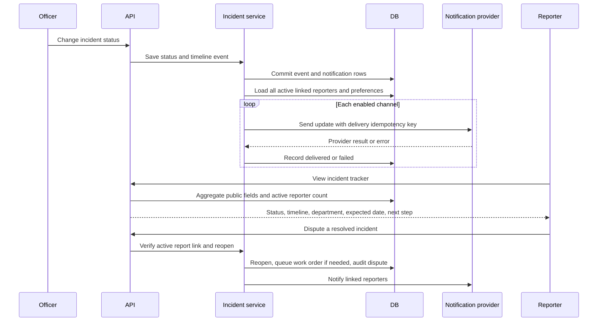

# Phase 5 — Follow-up and citizen awareness

This phase moves follow-up from individual complaints to the shared incident. It gives reporters a privacy-safe status page, lets them choose notification channels, and records each attempted delivery.

## Lifecycle



## Data and behavior

- `IncidentTimeline` stores incident-level events. The public tracker builds descriptions from event types and statuses; it does not return internal notes or complaint text.
- `IncidentNotificationPreference` stores SMS and email opt-ins. With no preference row, a channel with a saved contact is enabled by default.
- `NotificationDelivery` stores one row for each incident event, recipient, and channel. A unique constraint on that tuple supports retries without creating another delivery record. Provider outcomes are recorded as `delivered` or `failed`; exceptions are reduced to a generic stored error.
- Status changes notify every user with an active report link. A new linked report can be notified alone when the pipeline supplies a recipient filter.
- The public tracker exposes incident title/category/status/priority, distinct active reporter count, department when a work order identifies one, expected SLA date, and a short next-step explanation. It never returns reporter names, contacts, individual report text, or photos.
- `/api/incidents/by-report/{complaint_id}/tracker` checks ownership before resolving a report to the same public tracker. Officers and admins can inspect any report link.
- A citizen can dispute only a resolved incident for which they have an active linked report. Reopening writes an audit event and queues a new work order only when there is no active one.
- SLA monitoring now scans active incidents. It records one escalation per tier in the incident timeline, upgrades medium priority to high, and updates associated work-order priority.
- When resolution verification resolves a shared incident, active linked reporters receive a resolution update through the same fan-out service.

## Migration

Alembic revision `0004_incident_follow_up` adds incident priority, the incident timeline, notification preferences, and delivery records. Existing incidents receive priority from their most recently created work order where available, otherwise `medium`. Notification tables start empty; reporters without preferences use the documented default described above.

## What to remember

1. One incident can have many original complaints. The tracker reports a distinct active reporter count without exposing the reporter set.
2. The delivery row is an application-level idempotency record. The mock SMS adapter honors the key; a real email provider may accept a message and fail before Namma Civic stores its response, so end-to-end exactly-once delivery is not guaranteed.
3. Provider success currently includes queued/sent/confirmed statuses as returned by the adapter; it does not prove a person read the message.
4. Expected dates are estimates derived from incident creation time and priority (12/24/48/72 hours for critical/high/medium/low). The calculation is a simple rule, not a department-specific SLA calendar.
5. The public tracker endpoint intentionally allows public incident status lookup by incident ID. The report-based endpoint is authenticated and ownership-checked.
6. Delivery fan-out happens after the incident/timeline transaction commits. A provider outage is recorded per channel and does not roll back the civic status change. Automated retries of failed provider sends are not yet scheduled.

## See it locally

From `backend/`, run the offline tests for tracker privacy, preferences, delivery outcomes, dispute/reopen, and incident SLA behavior:

```powershell
& "$env:TEMP\civicfix-phase0-venv\Scripts\python.exe" -m pytest tests\test_incident_followup.py -q --tb=short
```

The tests use local SQLite and mocked notification tools; they do not make live SMS, email, or LLM calls.
