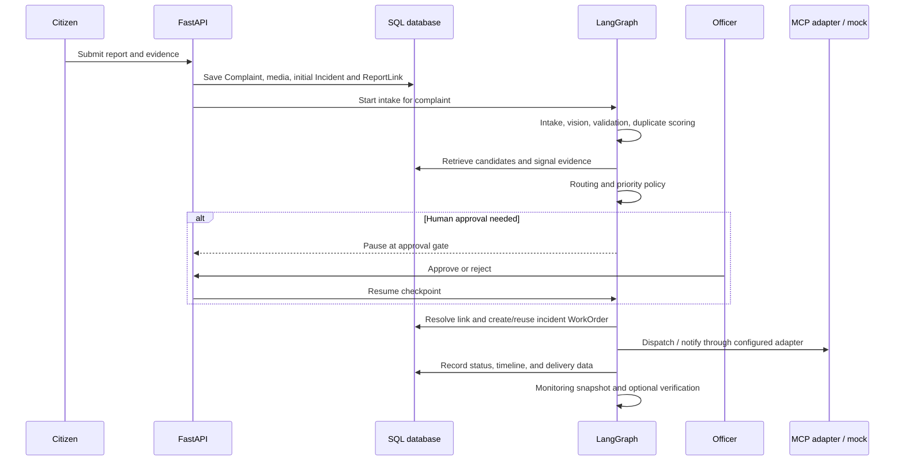

# Namma Civic learning guide

For Windows startup and home page copy/layout notes, see [Local run and UI](08-local-run-and-ui.md).

This guide follows one civic report from submission through incident matching and follow-up. It describes the repository as it exists now: a working software prototype with deterministic offline tests and simulated external operations, not a municipal production deployment.

## 1. The problem

Citizens can report civic issues through a web-facing API using the supported source values. Multiple reports can describe one real-world issue. The system must preserve each original report and reporter while avoiding duplicate incidents and work orders.

The prototype addresses that by keeping `Complaint` as source evidence, connecting reports to an `Incident` through versioned `ReportLink` records, and attaching operational `WorkOrder` records to incidents. See [the system map](00-system-map.md) and [data model](01-data-model.md).

## 2. Architecture and request lifecycle

The React/Vite frontend calls FastAPI routes. SQLAlchemy persists records through Alembic-managed schema versions. A LangGraph workflow coordinates node functions. The graph is stateful within one process through LangGraph `MemorySaver`; SQL is the durable store for reports and operations.



The graph has ten nodes: `intake`, `vision`, `validation`, `deduplication`, `routing`, `priority`, `approval`, `action`, `monitoring`, and `resolution_verification`. Some are thin orchestration wrappers around existing services. A node name does not imply a separately deployed autonomous AI model. Read [the pipeline guide](04-agent-pipeline.md).

## 3. Data model and evidence preservation

- `Complaint` records each citizen's submitted text, reporter, channel, location, and status. Submitted title, description, and category are immutable through the update API.
- `ComplaintMedia` stores media metadata and optional perceptual hash. Original media are associated with their original complaint.
- `Incident` groups reports about one operational issue.
- Versioned `ReportLink` rows preserve association decisions and score evidence. Exactly one link per report is active under the partial unique database index.
- `WorkOrder` belongs to an incident. A partial unique index limits each incident to one active work order; completed and canceled orders remain history.

See [the data-model walkthrough](01-data-model.md). Officer link decisions are described in [officer review](06-officer-review.md).

## 4. Duplicate detection

Candidate retrieval uses a coordinate bounding box and a capped SQL query. The pure matching engine compares distance, category compatibility, token Jaccard, character n-grams, pHash, time, and address/landmark overlap; it ranks candidates and returns `auto_link`, `officer_review`, or `new_incident`. Missing location cannot be auto-linked using text alone. Conflicting photo hashes can force review.

Current thresholds (`0.66` auto-link and `0.58` review) came from a held-out **synthetic** pair evaluation. The held-out set is small and hand-authored; its precision, recall, F1, and ablations are not real-world accuracy claims. See [duplicate detection](03-duplicate-detection.md) for the signal math, evaluation, and failure modes.

For a strong match to a resolved incident, the approved policy creates a new incident with `recurrence_of_incident_id`; it does not silently reopen the resolved record. Ambiguous reports that could bridge incidents go to officer review.

## 5. Agent workflow and human review

Intake calls the configured provider once for a report, then the vision node exposes those findings without making a second model call. Validation, deduplication, routing, and priority produce state for the next stage. Critical or uncertain cases can pause for officer approval. The action node rescans while holding a database serialization lock, updates report links, and persists/reuses work orders idempotently. See [the pipeline guide](04-agent-pipeline.md).

The officer queue displays report and candidate evidence, scores, and available photo/location context. Decisions are recorded as audit data and labeled examples. The threshold recalibration script reports a recommendation but does not apply it. See [officer review](06-officer-review.md).

## 6. Follow-up and transparency

Incidents have status/timeline and reporter-notification records. Preferences are applied per channel. A public incident tracker returns operational details and aggregate counts without reporter contact data or report descriptions. SLA escalation is performed by a scheduled worker; the graph's monitoring node provides a snapshot and delegates escalation to that worker. Resolution checks use a heuristic service and optional evidence, not a trained visual before/after model. See [follow-up](05-follow-up.md).

## 7. Evaluation and verification

Run backend tests and the synthetic five-report scenario from `backend/` in PowerShell:

```powershell
& "$env:TEMP\civicfix-phase0-venv\Scripts\python.exe" -m pytest -q --tb=short
& "$env:TEMP\civicfix-phase0-venv\Scripts\python.exe" scripts\run_phase7_demo.py
```

The Phase 7 run recorded one incident, one work order, five preserved synthetic reports across four channels, and notification records for five synthetic reporters. The AI is mock and external dispatch/notification calls are locally faked. Full commands and outputs are recorded in [verification](07-verification.md).

## 8. Limitations

- Synthetic duplicate data does not establish accuracy on real city reports. Thresholds need representative labeled local data and monitored review outcomes.
- There is no evidence here that the app handles thousands of complaints at production throughput.
- LangGraph checkpoints use in-memory `MemorySaver`. Restart loses paused graph state, though committed SQL records remain.
- SMS and work-order MCP handlers return synthetic results; email may use SMTP if configured. Offline tests and the Phase 7 demo replace tool calls with deterministic fakes.
- Channel adapters normalize payloads for web, mobile, voice, and WhatsApp, but the repository does not implement a live connector for each external channel.
- Image pHash is perceptual similarity, not object recognition. N-grams do not understand meaning and can miss paraphrases or match common phrases.
- Geocoding and map tiles may depend on network-backed services. Location evidence can be wrong or imprecise.
- The database serialization lock is correctness-oriented prototype logic; production concurrency and lock performance require deployment testing.
- Image bytes are checked for readability. The system does not claim full malware scanning or complete media-format security analysis.
- Citizen access is restricted on the tested report APIs, but the project has not received an independent security audit or penetration test.
- The app is not connected to an actual municipal dispatch or case-management system in this verification.

## Learning sequence

| Order | Topic | Guide |
|---|---|---|
| 1 | Phase 0 baseline snapshot (historical) | [00-system-map.md](00-system-map.md) |
| 2 | Incidents and report links | [01-data-model.md](01-data-model.md) |
| 3 | Channel normalization | [02-channels.md](02-channels.md) |
| 4 | Duplicate scoring and evidence | [03-duplicate-detection.md](03-duplicate-detection.md) |
| 5 | Agent pipeline | [04-agent-pipeline.md](04-agent-pipeline.md) |
| 6 | Follow-up and citizen tracker | [05-follow-up.md](05-follow-up.md) |
| 7 | Officer review and threshold feedback | [06-officer-review.md](06-officer-review.md) |
| 8 | End-to-end verification | [07-verification.md](07-verification.md) |
| 9 | Questions, terms, and demo | [Viva questions](viva-questions.md), [glossary](glossary.md), [demo script](demo-script.md) |

See [final requirement traceability](requirements-traceability.md) for the status and evidence for each problem-statement requirement.
